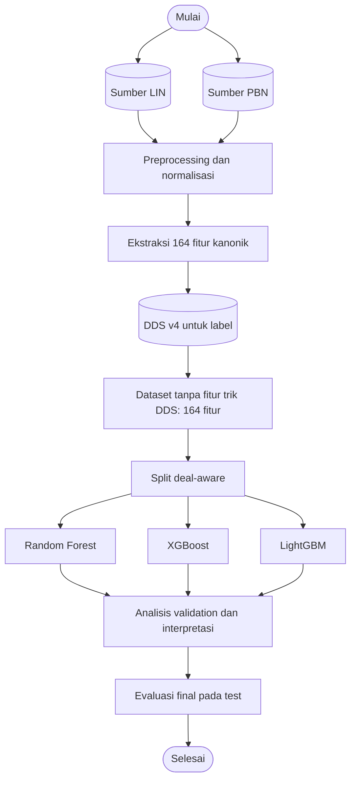

# Arsitektur dan Alur Pipeline

Pipeline utama mengklasifikasikan kecocokan kontrak aktual dengan kontrak par
dari rekaman LIN dan PBN. DDS v4 membentuk label; fitur jumlah trik DDS tidak
dipakai dalam model utama.

## Alur penelitian aktif

Dataset ekstraksi menyimpan 174 fitur termasuk 10 fitur jumlah trik DDS.
Notebook 04 membuat proyeksi 164 fitur tanpa kolom trik DDS dan memverifikasi
label, urutan board, serta partisi. Notebook 04 tidak melatih model. Notebook
05 melatih baseline pada proyeksi itu; Notebook 06–08 mengevaluasi baseline
dan kandidat pada fitur yang sama.

## Label, fitur, dan split

Label matches_par_contract bernilai 1 bila kontrak aktual cocok dengan salah
satu kontrak par berdasarkan level, strain, status double/redouble, dan sisi
declarer. Kolom par yang langsung membentuk label dikeluarkan dari fitur.
Dataset tanpa fitur trik DDS tetap memakai label yang dihitung DDS.

Split dikelompokkan menurut identitas kanonik deal 52 kartu. Deal yang sama
tidak melintasi train, validation, dan test. Dataset aktif berisi 50.227 baris
dengan 35.161 train, 7.534 validation, dan 7.532 test. Angka metrik yang
masih tersimpan berasal dari run lama dengan 174 fitur; perbarui dengan
menjalankan Notebook 05–08 berurutan.

## Modul utama

| Modul | Tanggung jawab |
|---|---|
| src/parser/lin_parser.py | Parse LIN ke BoardRecord |
| src/parser/pbn_parser.py | Parse PBN ke BoardRecord |
| src/features/engineer.py | Membuat 164 fitur kanonik |
| src/features/dds.py | Membuat label dan fitur DDS untuk ekstraksi |
| src/preprocessing/dataset_builder.py | Label, deduplikasi, dan split deal-aware |
| src/models/ | Wrapper Random Forest, XGBoost, dan LightGBM |
| src/evaluation/metrics.py | Metrik klasifikasi biner |

## Seleksi dan evaluasi

Validation dipakai memilih model dan threshold. AP (Average Precision) menjadi
metrik utama karena fokus pada kelas positif. F1 macro, F1 positif,
precision/recall, accuracy, dan ROC-AUC menjadi metrik pendamping. Test hanya
mengestimasi kandidat yang telah dikunci; peringkat semua kandidat pada test
bersifat deskriptif.
