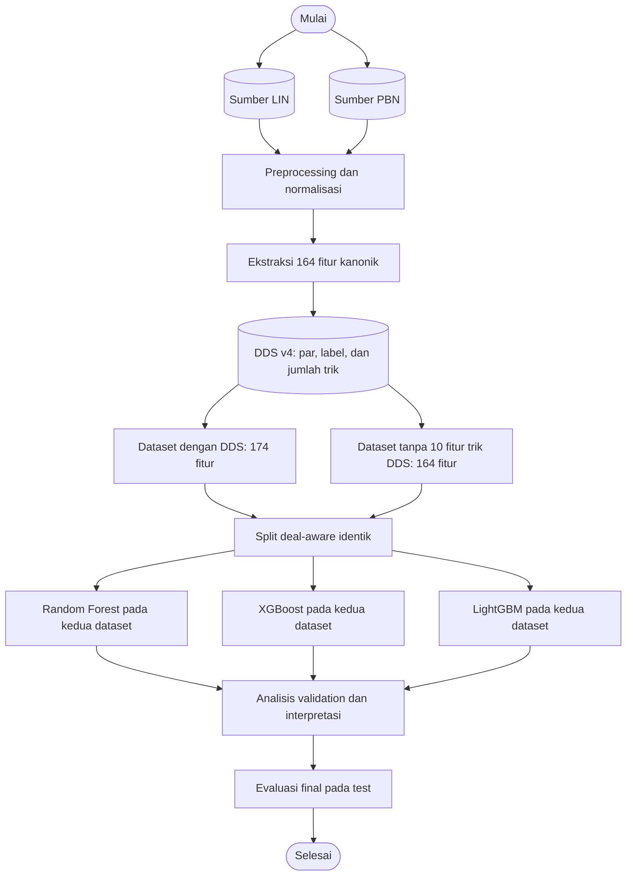

# Arsitektur dan Alur Pipeline

Pipeline resmi membangun klasifikasi biner kecocokan kontrak par dari rekaman
LIN dan PBN. Definisi label dan skema fitur berada di `src/`; notebook
`01` sampai `08` mengorkestrasi preprocessing,
analisis, pemodelan, dan evaluasi.

## Alur penelitian sesuai diagram



LIN dan PBN adalah dua format sumber yang digabung setelah parsing; dua kondisi
dataset penelitian adalah **dengan fitur DDS (174 fitur)** dan **tanpa fitur
trik DDS (164 fitur)**. Keduanya memakai board, target, dan split yang sama.
Istilah `tanpa DDS` merujuk pada pengeluaran sepuluh fitur jumlah trik; DDS v4
tetap menghitung label pada kedua kondisi.

Notebook 01 mengorkestrasi parsing, preprocessing, ekstraksi fitur, DDS,
pembentukan label, dan split resmi. Builder eksperimen tanpa DDS membuang hanya
sepuluh fitur trik dari data resmi, sehingga identitas baris dan split tetap
sama.

Dari 164 fitur kanonik, DDS menambahkan sepuluh fitur jumlah trik NS/EW pada
lima strain sehingga dataset utama memiliki 174 fitur. Kolom kontrak par yang
langsung membentuk label dikeluarkan dari kedua skema fitur. Record dengan
fitur dan label identik dideduplikasi; record dengan fitur ringkas sama tetapi
label berbeda dipertahankan.

Kedua kondisi fitur dibagi berdasarkan `_deal_key`, identitas kanonik deal 52
kartu. Ketiga algoritma dilatih pada kedua kondisi untuk ablation; perbandingan
utama penelitian memakai dataset resmi 174 fitur. Validation memilih model,
konfigurasi, dan threshold menggunakan AP sebagai metrik utama. Hasil test
mengestimasi pilihan yang telah dikunci; peringkat semua kandidat pada test
hanya bersifat deskriptif.

## Pencegahan kebocoran split

Setiap deal diberi `_deal_key` dari kartu pada keempat tangan dalam urutan
kanonik. Identitas ini tidak bergantung pada nama file, nomor papan, format
LIN/PBN, atau urutan kartu dalam file. `StratifiedGroupKFold` membagi berdasarkan
`_deal_key`, sehingga salinan deal dari sumber berbeda tetap berada pada satu
partisi. Builder memeriksa overlap key antar train, validation, dan test sebelum
menyimpan CSV. `_deal_key` hanya metadata dan tidak pernah menjadi fitur model.

Pengulangan dengan fitur **dan label** yang sama dihapus. Baris dengan fitur
ringkas sama tetapi label berbeda dipertahankan sebagai observasi berbeda.

## Modul utama

| Modul | Tanggung jawab |
|---|---|
| `src/parser/lin_parser.py` | Parse LIN, kartu, auction, kontrak dan metadata board |
| `src/parser/pbn_parser.py` | Parse PBN ke bentuk `BoardRecord` yang sama |
| `src/features/engineer.py` | Membuat 164 fitur kanonik dan kolom target historis |
| `src/features/dds.py` | Menghitung/membaca fitur DDS dan kontrak par |
| `src/preprocessing/dataset_builder.py` | Membuat label, menghapus kolom leakage, deduplikasi dan split grup deal |
| `src/models/` | Wrapper Random Forest, XGBoost, dan LightGBM |
| `src/evaluation/metrics.py` | Accuracy, precision/recall/F1, ROC-AUC, dan Average Precision |
| `scripts/run_pipeline.py` | Membangun dataset biner LIN+PBN dan melatih baseline dari config |

## Evaluasi

Validation dipakai memilih model dan threshold. Test dipakai sekali untuk
melaporkan performa pilihan yang telah dikunci. Tabel beberapa kandidat pada
test bersifat deskriptif dan tidak boleh dipakai untuk memilih pemenang.

Untuk fokus kelas positif, laporkan Average Precision (AP; disebut PR-AUC di
sebagian plot), ROC-AUC sebagai metrik ranking tambahan, serta F1/precision/recall
pada threshold yang dipilih di validation. Angka proporsi kelas dan rasio
mayoritas:minoritas perlu dilaporkan bersama metrik.

## Perintah pipeline

```powershell
python scripts/build_dds_cache.py  # hanya jika cache v4 belum tersedia
python scripts/run_pipeline.py    # membangun split deal-aware dan melatih baseline
```

Notebook 01 sampai 08 menjalankan alur penelitian aktif: preprocessing dan ekstraksi, eksplorasi, analisis fitur, ablasi, pemodelan, analisis hasil, eksperimen kandidat, dan evaluasi final. `scripts/run_pipeline.py` menggunakan target biner dan cache v4.
