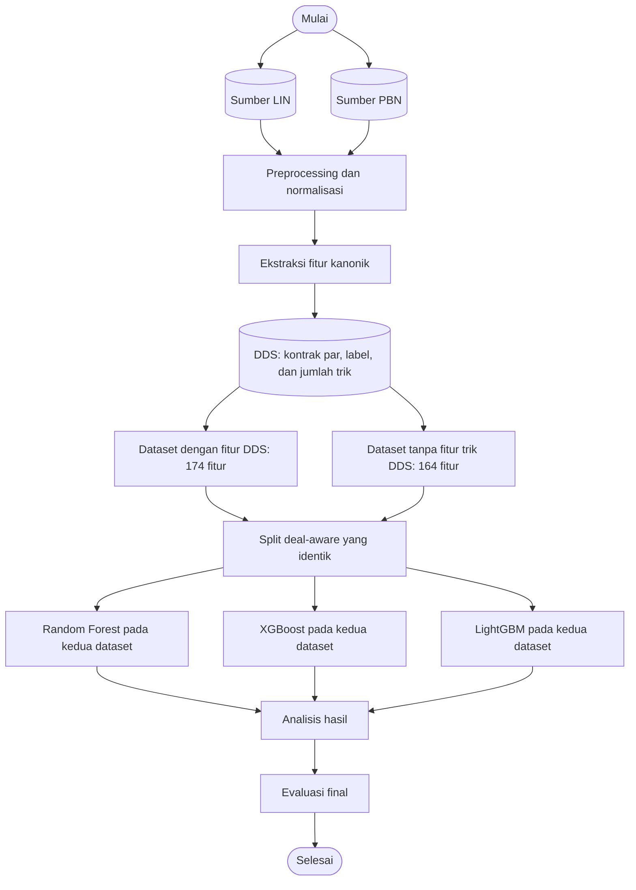

# Tahapan Penelitian

Penelitian membandingkan Random Forest, XGBoost, dan LightGBM untuk klasifikasi
biner kecocokan kontrak aktual dengan kontrak par pada Contract Bridge. Alur
penelitian membedakan format sumber data dari dua kondisi dataset fitur.

## 1. Sumber data dan preprocessing

Sumber mentah terdiri dari 606 file LIN (BBO) dan 1.390 file PBN (arsip
turnamen). Parser masing-masing format menormalkan data ke `BoardRecord`, lalu
kedua sumber digabung. LIN dan PBN adalah format sumber; keduanya bukan dua
kondisi eksperimen yang dibandingkan.

Board divalidasi dan diberi identitas kanonik dari susunan 52 kartu.

## 2. Ekstraksi data dan DDS

Dari board yang lolos preprocessing, sistem mengekstrak 164 fitur kanonik
tangan/auction dan kontrak aktual. DDS v4 menghitung jumlah trik NS/EW untuk
lima strain dan seluruh alternatif kontrak par. Label `matches_par_contract`
bernilai 1 bila kontrak aktual cocok dengan salah satu kontrak par pada level,
strain, status double/redouble, dan sisi declarer; selain itu 0. Kolom par yang
langsung membentuk label dikeluarkan dari fitur untuk mencegah leakage.

## 3. Dua kondisi dataset fitur

Kedua kondisi berasal dari board, label, dan sumber gabungan yang sama:

- **Dengan fitur DDS:** 164 fitur kanonik + 10 fitur jumlah trik DDS = 174 fitur.
- **Tanpa fitur DDS:** hanya 164 fitur kanonik; sepuluh fitur jumlah trik DDS
dikeluarkan.

Istilah "tanpa DDS" dalam eksperimen berarti tanpa **fitur jumlah trik DDS**.
DDS tetap digunakan untuk menghitung label `matches_par_contract` pada kedua
kondisi. Ablation ini mengisolasi kontribusi sepuluh fitur DDS, bukan
menghilangkan solver dari definisi target. Setelah label terbentuk, rekaman
dengan fitur dan label identik dideduplikasi; fitur ringkas sama dengan label
berbeda tetap dipertahankan.

Dataset gabungan memiliki 50.227 observasi dan 24,56% label positif.

## 4. Split data

Train, validation, dan test dikelompokkan berdasarkan identitas deal 52 kartu.
Tidak ada deal yang melintasi partisi. Kedua kondisi fitur menggunakan baris,
label, dan pembagian yang identik: 35.161 train, 7.534 validation, dan 7.532
test.

## 5. Pemodelan

Random Forest, XGBoost, dan LightGBM dilatih pada split train yang sama untuk
masing-masing kondisi fitur. Perbandingan utama algoritma menggunakan dataset
resmi 174 fitur; kondisi 164 fitur menjadi eksperimen ablation untuk mengukur
kontribusi fitur jumlah trik DDS.

## 6. Analisis hasil

Validation digunakan membandingkan kandidat dan memilih konfigurasi. Average
Precision (AP) menjadi metrik utama karena kelas positif adalah minoritas.
F1 macro, F1 positif, precision, recall, ROC-AUC, dan accuracy adalah metrik
pendamping. Threshold dipilih pada validation. SHAP dan feature importance
membantu menginterpretasi perilaku model, bukan hubungan sebab-akibat.

## 7. Evaluasi final

Setelah kandidat dan threshold dikunci berdasarkan validation, test digunakan
untuk mengestimasi performa akhir. Kandidat lain pada test hanya ditampilkan
secara deskriptif. Di run terbaru, Random Forest Exp E terpilih berdasarkan AP
validation; hasil test-nya AP 0,6383 dan F1 macro 0,7309. Rincian hasil dan
ablation terdapat di [EXPERIMENTS.md](EXPERIMENTS.md) dan
[REPORT.md](../outputs/results/REPORT.md).

## Notebook yang merealisasikan tahapan

- `01_data_extraction.ipynb`: preprocessing, ekstraksi, DDS, label, dan split.
- `02_data_exploration.ipynb`: pemeriksaan tabel board dan dataset hasil ekstraksi.
- `03_feature_analysis.ipynb`: pemeriksaan distribusi dan fitur.
- `04_dds_feature_ablation.ipynb`: dua kondisi fitur dan pembandingan algoritma
  untuk mengukur kontribusi sepuluh fitur trik DDS.
- `05_modeling.ipynb`: baseline tiga algoritma pada dataset resmi 174 fitur.
- `06_evaluation.ipynb`: analisis dan evaluasi baseline.
- `07_improvement_experiments.ipynb`: analisis kandidat eksperimen pada validation.
- `08_final_evaluation.ipynb`: pemilihan terkunci dan evaluasi test final.
