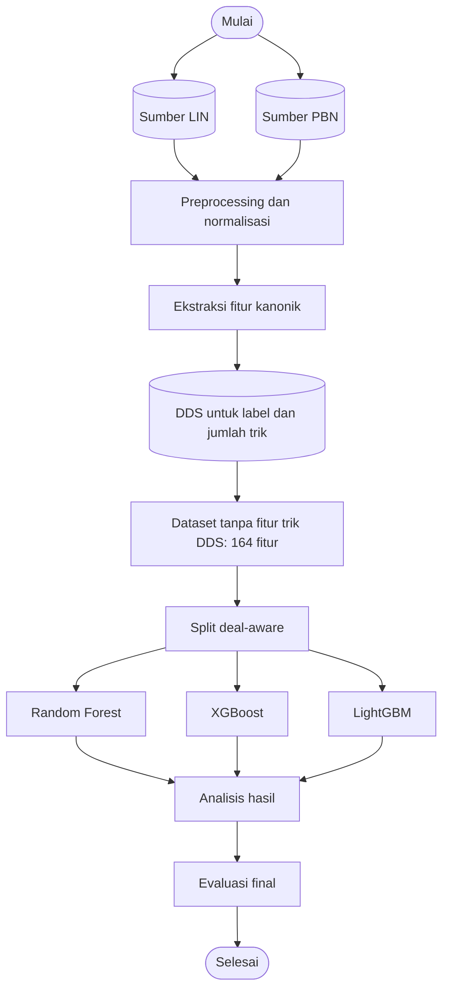

# Tahapan Penelitian

Penelitian mengklasifikasikan kecocokan kontrak aktual dengan kontrak par
menggunakan Random Forest, XGBoost, dan LightGBM. Dataset yang digunakan
untuk pemodelan tidak memuat fitur jumlah trik DDS. DDS tetap dipakai untuk
membentuk label.

## 1. Sumber data dan preprocessing

Sumber mentah terdiri dari 606 file LIN (BBO) dan 1.390 file PBN (arsip
turnamen). Parser menormalkan kedua format menjadi BoardRecord dan
menggabungkannya. Setiap deal divalidasi dan mendapat identitas kanonik dari
susunan 52 kartu.

## 2. Ekstraksi data dan DDS

Ekstraksi menghasilkan 164 fitur kanonik dari tangan, auction, dan kondisi
board. DDS v4 menghitung jumlah trik untuk lima strain dan seluruh alternatif
kontrak par. Label matches_par_contract bernilai 1 bila kontrak aktual cocok
dengan salah satu kontrak par dalam level, strain, status double/redouble,
dan sisi declarer; selain itu 0. Kolom par yang langsung membentuk label tidak
dipakai sebagai fitur.

## 3. Dataset untuk pemodelan

Dataset hasil ekstraksi memiliki 174 fitur: 164 fitur kanonik dan 10 fitur
jumlah trik DDS. Proyeksi untuk pemodelan mengeluarkan sepuluh fitur jumlah
trik tersebut sehingga menjadi dataset 164 fitur. DDS tetap digunakan untuk
label. Rekaman dengan fitur dan label identik dideduplikasi; rekaman dengan
fitur ringkas sama tetapi label berbeda tetap dipertahankan.

## 4. Split data

Train, validation, dan test dikelompokkan berdasarkan identitas deal 52 kartu
agar deal yang sama tidak melintasi partisi. Dataset tanpa fitur DDS memiliki
35.161 baris train, 7.534 validation, dan 7.532 test.

## 5. Pemodelan dan analisis

Notebook 05 melatih baseline Random Forest, XGBoost, dan LightGBM. Notebook 06
mengevaluasi model baseline. Notebook 07 menguji kandidat dan threshold dengan
validation sebagai dasar pemilihan. AP menjadi metrik utama; F1 macro, F1
positif, precision, recall, ROC-AUC, dan accuracy menjadi metrik pendamping.
SHAP dan feature importance dipakai untuk interpretasi prediksi, bukan untuk
menyatakan hubungan sebab-akibat.

## 6. Evaluasi final

Notebook 08 memilih kandidat berdasarkan validation dan menggunakan test
untuk estimasi akhir. Peringkat kandidat lain pada test hanya bersifat
deskriptif. Hasil yang saat ini tersimpan berasal dari pipeline lama dengan
174 fitur; Notebook 05–08 perlu dijalankan ulang untuk memperoleh hasil final
pada dataset 164 fitur.

## Notebook yang merealisasikan tahapan

- 01_data_extraction.ipynb: parsing, preprocessing, ekstraksi, DDS, label, split.
- 02_data_exploration.ipynb: pemeriksaan data hasil ekstraksi.
- 03_feature_analysis.ipynb: analisis fitur sebelum pemodelan.
- 04_dds_feature_ablation.ipynb: menyiapkan dan memeriksa dataset tanpa fitur
  trik DDS; tidak melatih model.
- 05_modeling.ipynb: pelatihan tiga baseline pada dataset 164 fitur.
- 06_evaluation.ipynb: evaluasi baseline.
- 07_improvement_experiments.ipynb: eksperimen kandidat pada validation.
- 08_final_evaluation.ipynb: pemilihan kandidat dan evaluasi test.
